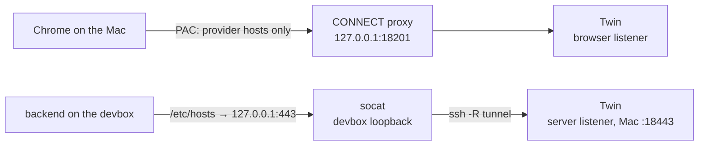

# owlauthtwin

OwlAuth Twin is a local stand-in for OAuth vendors and their MCP servers (Gmail, monday.com,
Workday, Atlassian and more). With it you test Samsara connectors end to end through Agent Studio
on a devbox, with no real vendor account. Dev only. It uses no real secrets.


## How to install

On your Mac, paste this into a terminal. You need git and a GitHub SSH key; `gh` is not needed.

```bash
git clone git@github.com:samsara-dev/owlauthtwin.git ~/owlauthtwin && ~/owlauthtwin/install.sh
```

The script:

- installs uv with Homebrew, if it is missing;
- puts `owltwin` on your PATH (`~/.local/bin`, added once to `~/.zshrc` and `~/.bash_profile`);
- downloads the app's Python packages.

It changes nothing else on the Mac. You also need the `devbox` CLI and a running devbox.

```bash
owltwin
```

That opens the panel at http://127.0.0.1:18200/. `owltwin` checks for updates on startup
(`git pull --ff-only`); pass `owltwin --no-update` (or set `OWLTWIN_NO_UPDATE=1`) to skip, or run
`owltwin update` manually. To stop, press Ctrl+C.

## Use

1. **Setup:**
   - Pick a devbox, the connector to show first, and **Full stack** or **Twin only**.
   - Optionally turn on the feature flags for Agent Studio access.
   - Click **Start session**. That one click is your go-ahead.

   The Twin serves every connector in `providers/*.yaml` that lints, all at once.

   **Full stack** sets up the whole devbox by itself:

   - the Mac proxy and the tunnel;
   - the devbox route and CA;
   - repos (`devbox provision`), the code sandbox, aiml-agents and the backend, in tmux
     `owltwin-run` (including local `notificationeventingestionservice` and
     `inboxnotificationworker` so Expire token can write Notification Center rows);
   - `FC_USE_DEV_OVERRIDES=1` so connector / needs-attention feature configs turn on locally;
   - the Agent Studio tunnel.

   **Twin only** adds just the route and the CA. Your own backend and aiml-agents stay as they
   are.

   A card asks you to step in only when something needs you: confirming the AWS sign-in (its page
   opens by itself), a project you started yourself (**Take over**), or a crash.
2. **Running:**
   - Left: the values to paste into Agent Studio, and Twin actions (Expire token, Rotate secret,
     Revoke).
   - Centre: **Activity**, every request to the Twin, for every connector.
   - Right: the request you clicked, with Copy as curl.

   The health bar turns red, with a banner, when something breaks.

**Stop** undoes what the session set up: the Mac proxy, the tunnel, the devbox route, and what
runs in `owltwin-run`. The CA files and the flag overrides stay. **Continue last session** (within
12 h) keeps the Twin's secrets and tokens, so connected connectors keep working.

## How traffic reaches the Twin



- Provider hosts have no DIRECT fallback, so they fail closed when the app is down.
- The Twin's CA is never added to the keychain. In Chrome, type `thisisunsafe` once per host. The
  backend trusts the CA through `SSL_CERT_FILE=~/.owltwin/combined-ca.pem`.
- `owltwin lint` refuses wildcards and shared or company hosts (Okta, Zscaler, Samsara).
- Google and Microsoft sign-in hosts are allowed only when a provider lists them under
  `idp_hosts:`. In Chrome they go to the Twin only while **Intercept sign-in** is on: at most
  10 minutes, or until the first token.

## Providers

Each catalog entry in `agentconnectorservice/catalog/entries.go` has one YAML file in
`providers/`. `owltwin lint` checks them.

| Kind | Providers |
|---|---|
| OAuth, fixed client | `workday`, `gmail`, `google-calendar`, `microsoft-entra`, `microsoft-365` |
| OAuth, DCR (`client.registration: dynamic`) | `monday`, `ramp`, `ramp-demo`, `rippling`, `teamwork-desk`, `mangoapps-wiki`, `atlassian-oauth` |
| API token (`api_key:`) | `atlassian` |

For DCR providers, the Twin reproduces these vendor behaviours:

- RFC 9728 and RFC 8414 discovery;
- registration (RFC 7591);
- `resource=` (RFC 8707);
- public and confidential clients;
- rejecting an unknown client_id or redirect_uri.

## Settings

| Variable | Effect |
|---|---|
| `OWLTWIN_AWS_PROFILE`, `OWLTWIN_AWS_REGION` | AWS profile and region the backend runs with on the devbox; the AWS sign-in uses that profile's sso-session. Unset: the devbox's own defaults. |
| `OWLTWIN_ORG` | Default org for the Agent Studio flag overrides (205) |
| `OWLTWIN_PORT`, `OWLTWIN_PROXY_PORT`, `OWLTWIN_SERVER_PORT` | Ports (18200, 18201, 18443) |
| `OWLTWIN_HOME`, `OWLTWIN_REPO` | Where `install.sh` clones, and from where |
| `OWLTWIN_NO_DEVBOX=1`, `OWLTWIN_NO_SYSTEM_PROXY=1`, `OWLTWIN_FAKE_DEVBOXES=1` | UI work with no devbox and no Mac proxy change |
| `OWLTWIN_PROVIDERS`, `OWLTWIN_STATE_DIR` | Provider folder; state folder (`~/.local/state/owltwin`) |

## Development

Run the tests with stdlib `unittest`. They fake the Mac proxy and never change it.

```bash
cd app && uv run python -m unittest discover -s tests
```

```bash
cd app && uv run ruff check .
```

Code layout:

- The panel is Flask (`web.py`) with Jinja2 templates in `app/owltwin_app/templates/`.
- The Twin (`twin.py`) and the CONNECT proxy (`proxy.py`) use plain `http.server`.
- Lines are at most 100 characters. `ruff format` is not used.

| Path | What |
|---|---|
| `owltwin` | Launcher: `owltwin`, `owltwin lint`, `owltwin update` |
| `install.sh` | Mac install and update |
| `providers/*.yaml` | One file per provider |
| `app/owltwin_app/` | The app |
| `app/tests/` | Tests |
| `docs/owltwin-demo.gif` | The demo above: the panel over a real Twin with a fake devbox |
