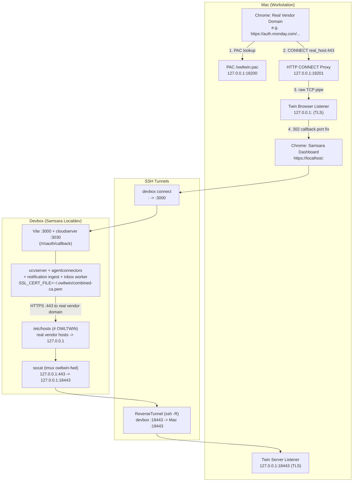
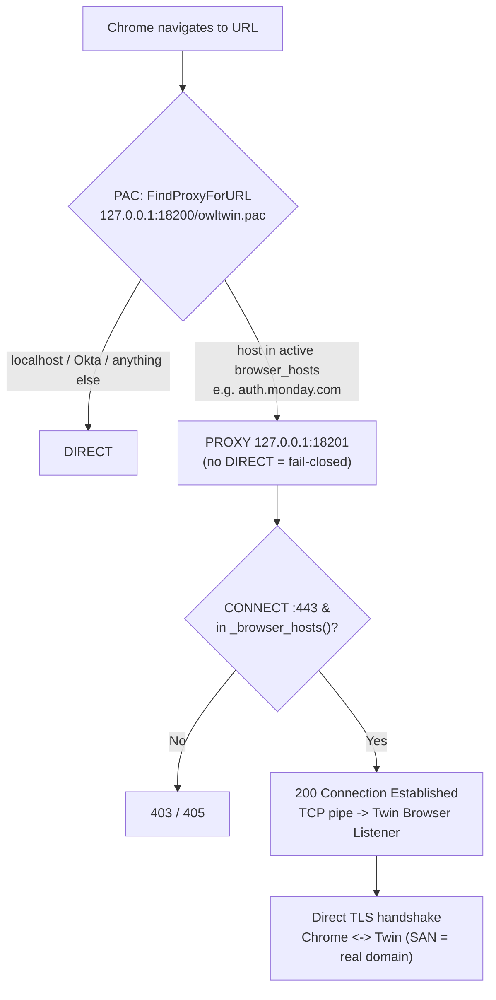
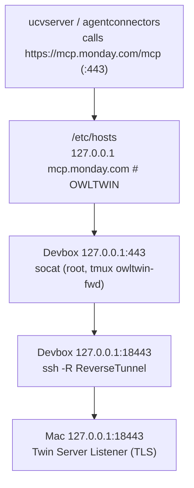
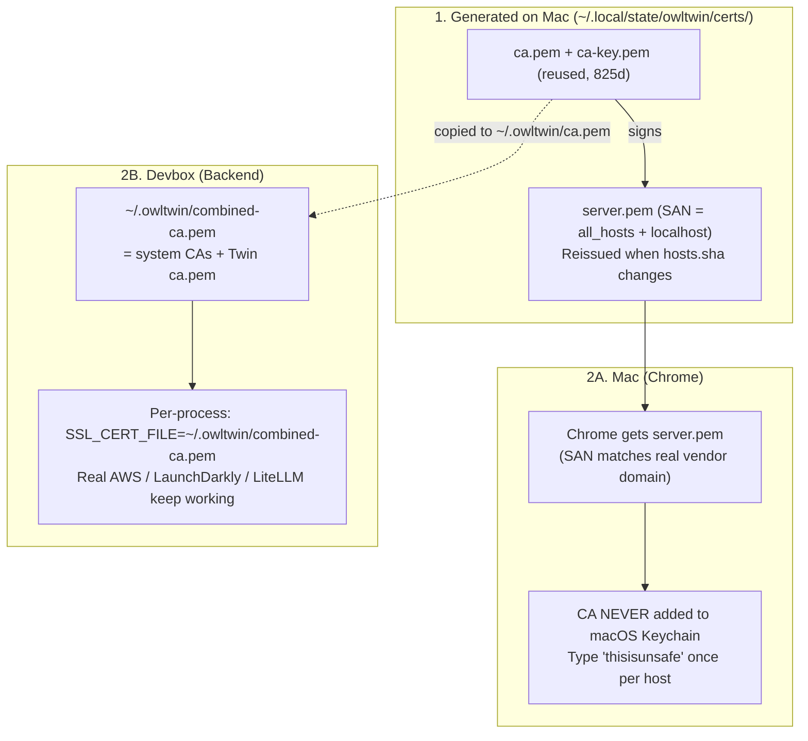
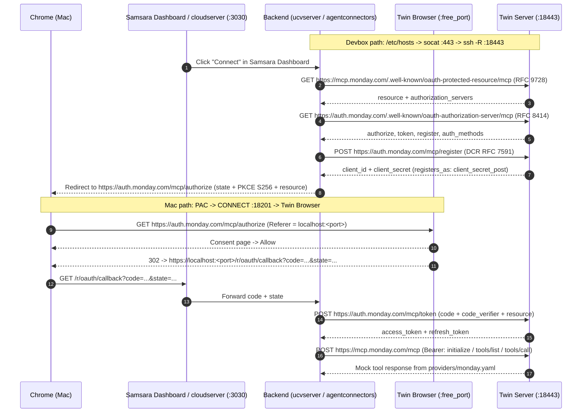

# OwlAuth Twin — Overview

> **Summary:** Routing **localdev** (Mac Chrome + Devbox backend) to local vendor mocks under **real production vendor domains** (`auth.monday.com`, `mcp.monday.com`, `accounts.google.com`, `mcp.atlassian.com`) with **zero code changes in Samsara**.

---

## 1. Why It Was Built — The Localdev Pain Points

- **Tests don't show the real UX or cross-service picture:** Most OAuth and MCP flows can be simulated in automated tests, but tests don't reflect the real end-to-end user experience we expose users to—and it isn't always easy to understand how all the underlying services connect together.
- **Real vendor accounts & callback access:** Testing real integrations requires vendor accounts + admin access to register local callback URLs (`/r/oauth/callback`), and you still cannot trigger edge cases (expired tokens, rotated secrets, revoked grants) on demand.
- **Different devboxes, different ports:** Samsara Dashboard runs on `:3000`, `:13000`, `:23000`, etc. Localdev computes `redirect_uri` from `DEVBOX_INDEX * 10000` (often unset/wrong), breaking the OAuth redirect back to Chrome.
- **Localdev port & env traps:** `USE_VITE_DEVPROXY=true` sends callbacks to shared staging `devproxy`; `aiml-agents` steals Redis `:6380` from the backend; `claude_core` defaults to mocked `e2b` instead of `local_docker` and hangs without `LITELLM_API_KEY` or `DD_DOGSTATSD_DISABLE_FORK_SUPPORT=1`.
- **Slow, fragile setup on fresh devboxes:** Bootstrapping 2 repos (`backend` + `aiml-agents`), `direnv allow`, `bin/setup.sh`, exact services, AWS SSO, and DynamoDB flag overrides takes too many manual steps—even an agent rarely gets it right on the first try.

---

## 2. Core Idea: Two Traffic Paths + One Local TLS Model

- **Real domains, zero Samsara changes:** Both Chrome and the Devbox backend keep calling real vendor URLs.
- **One Mac process serves all defined providers:** Two modes—**Full stack** (provisions & runs everything in tmux `owltwin-run`) or **Twin only** (routing + CA only).

**Quick key to terms in this diagram:**
- **PAC:** macOS JS proxy rule—steers *only* Twin `browser_hosts` to `:18201`; `localhost` & everything else go `DIRECT`.
- **HTTP `CONNECT` Proxy (`:18201`):** Raw TCP tunnel for allowlisted `browser_hosts` (`:443`); never decrypts TLS.
- **`socat` (`:443 -> :18443`):** Root forwarder on the Devbox bridging `:443` to the unprivileged SSH tunnel port.
- **`ReverseTunnel` (`ssh -R`):** Forwards Devbox `:18443` back to the Twin Server Listener (`:18443`) on the Mac.
- **`combined-ca.pem`:** System CA roots + Twin CA so backends trust the Twin *and* real AWS/LaunchDarkly/LiteLLM.

---

## 3. Part 1 — Mac Browser Path (PAC + HTTP `CONNECT`)

**Key points:**
- **Why PAC instead of Mac `/etc/hosts`?** No `sudo`, leaves non-browser processes alone, and lets us toggle Google/MS domains dynamically (`?v=<timestamp>` busts cache).
- **Fail-closed:** No `DIRECT` fallback for Twin hosts—if OwlAuth Twin stops, Chrome errors locally instead of hitting production vendors.
- **Time-boxed `idp_hosts`:** Okta/Zscaler/Samsara are always blocked (`owltwin lint`). Google/Microsoft hosts route to the Twin in Chrome *only* while **Intercept sign-in** is ON (max 10 min or until first token exchange).
- **Callback port fix:** Reads Chrome's real port from `Referer` on `/authorize` and redirects Chrome to `localhost:<port>/r/oauth/callback`, while `/token` still validates the backend's original `redirect_uri`.

---

## 4. Part 2 — Devbox Backend Path (`/etc/hosts` + `socat` + `ssh -R`)

**Key points:**
- **Tagged `/etc/hosts`:** Entries end with `# OWLTWIN`, so `Stop` removes only Twin lines.
- **Why `socat`?** Backends always dial `:443`, which unprivileged `ssh -R` cannot bind. `socat` bridges `127.0.0.1:443 -> 127.0.0.1:18443` (and aborts safely if another process owns `:443`).
- **`ReverseTunnel` extras:** Keepalive + auto-reconnect + symlinks `$SSH_AUTH_SOCK` to `~/.owltwin/agent.sock` so `git` works inside `owltwin-run`.

---

## 5. Part 3 — TLS & Certificates (Mac vs Devbox)

**Key points:**
- **Mac stays clean:** Never touches macOS Keychain (`thisisunsafe` is scoped to Chrome only).
- **Why `combined-ca.pem`?** Twin CA alone would break outbound TLS to AWS, LaunchDarkly, and LiteLLM; `SSL_CERT_FILE` scopes trust per-process without altering OS trust stores.
- **Runtime detection:** `status()` checks `/proc/$pid/environ` on `ucvserver` / `agentconnectors` and flags missing CA (offering **Take over** in Full stack); `combined-ca.pem` stays after Stop so manual backends don't break.

---

## 6. Part 4 — End-to-End Flow (`monday.com` DCR Example)

**Key points:**
- **All defined providers run at once:** `TwinRegistry.route()` disambiguates shared hosts (e.g., Google, Atlassian) by: `listener/host` → `endpoint` → `client_id` → `issued token` → `Authorization scheme (Basic vs Bearer)` → panel fallback (`ambiguous`).
- **One-click fault injection:** *Expire access token* (`401`), *Rotate secret* (`invalid_client`), *Revoke tokens* (`400 invalid_grant`).

---

## 7. Modes, Safety & Cleanup (Quick Summary)

- **`Full stack` vs `Twin only`:** Full stack provisions `backend` + `aiml-agents`, sets `local_docker` sandbox, frees Redis `:6380`, opens AWS SSO in Chrome, sets `USE_VITE_DEVPROXY=false`, starts local `notificationeventingestionservice` + `inboxnotificationworker`, and writes `dynamodb-local` (`:8768`) flag overrides. Twin only sets up routing + CA and monitors your own services.
- **Safety:** Loopback-only (`127.0.0.1`), `owltwin lint` blocks `okta.com` / `zscaler.net` / `samsara.com` + wildcards, panel enforces `local_only` (DNS rebinding guard), never kills user processes without **Take over**.
- **Stop vs `Ctrl+C`:** `Stop` restores PAC from `proxy-saved.json`, kills `ssh -R`, removes `# OWLTWIN` hosts, stops `owltwin-fwd` / `owltwin-run`. `Ctrl+C` runs the same cleanup while keeping `session.json` (12h) for **Continue last session**.

---

## 8. Glossary

| Term | Short Explanation |
|---|---|
| **PAC (`owltwin.pac`)** | JS `FindProxyForURL` script registered via `networksetup`; routes only `browser_hosts` to `:18201`, everything else `DIRECT`. |
| **HTTP `CONNECT` Proxy** | TCP tunnel (`CONNECT host:443`) on `:18201`; forwards raw encrypted bytes to Twin without terminating TLS. |
| **Fail-closed** | PAC has no `DIRECT` fallback for Twin hosts—if OwlAuth Twin is down, requests fail instead of hitting real vendors. |
| **`ssh -R` / `socat`** | `ssh -R` forwards Devbox `:18443` -> Mac `:18443`; root `socat` bridges Devbox `:443` -> `:18443`. |
| **`agent.sock`** | Symlink kept alive by `ReverseTunnel` so `tmux` panes keep a working `SSH_AUTH_SOCK` for `git`. |
| **SAN (`hosts.sha`)** | Multi-domain X.509 extension listing all defined vendor hosts in one `server.pem` (auto-reissued on host changes). |
| **`combined-ca.pem` / `SSL_CERT_FILE`** | System CAs + Twin CA injected per-process so Devbox backends trust Twin *and* real AWS/LaunchDarkly/LiteLLM. |
| **`thisisunsafe`** | Chrome interstitial bypass passphrase—lets Chrome trust Twin locally without touching macOS Keychain. |
| **DCR (RFC 7591) & `registers_as`** | Dynamic `POST /register`; `registers_as` reproduces vendors that upgrade public `none` requests to `client_secret_post`. |
| **RFC 9728 / 8414 / 8707 / PKCE** | Protected-resource & auth-server discovery, `resource` token binding, and `S256` code challenge verification. |
| **`USE_VITE_DEVPROXY=false`** | Keeps `/r/oauth/callback` on local `cloudserver :3030` instead of shared staging `devproxy`. |
| **`dynamodb-local` overrides** | Writes `ORGFLAGS#<org>` rows on `:8768` so dev orgs get `agent-studio-enabled` / `credits-experience-enabled`. |
